<h1>
<picture>
  <source media="(prefers-color-scheme: dark)" srcset=".github/assets/banner-dark.svg" />
  
</picture>
</h1>

I'm a QA Engineer at **BossLabs.AI**, where I test client business platforms before they ship. On GitHub
I'm building a public QA automation portfolio: **one repo per testing skill**, each with its own CI,
real targets, and written findings. I'm working toward an **SDET** role, with Cybersecurity and Cloud
Engineering next.

## [ SELECTED RESULTS ]

| Result | How it was found | Evidence |
| --- | --- | --- |
| **A login flood froze the whole API.** 60 logins/s pushed an unrelated 2 ms read to 12 s at p95. | A k6 experiment traced it to synchronous password hashing (`scryptSync`) blocking Node's only thread. Fixed in TaskFlow with async `scrypt` and rate limiting on the auth routes. | [PERF-001](https://github.com/VincentJerico/performance-testing/blob/main/docs/FINDINGS.md#perf-001-login-traffic-stalls-every-other-request) · [fix](https://github.com/VincentJerico/taskflow-under-test/pull/18) |
| **7 WCAG 2.2 failures on a site where axe-core reported 0.** | A keyboard and manual audit after the automated scan passed. One of them, a cart keyboard users can't reach, blocks checkout. | [Audit](https://github.com/VincentJerico/accessibility-testing/blob/main/docs/FINDINGS.md#summary) |
| **8 security findings mapped to the OWASP Top 10.** | ZAP passive scan, header, cookie and error-page checks, and Trivy, against OWASP Juice Shop in Docker. Every check has a self-test that proves it can fail. | [Report](https://github.com/VincentJerico/security-testing/blob/main/docs/FINDINGS.md#summary) |
| **A stored XSS in an app I built.** | Found by a later test audit of TaskFlow. The original suite, which caught all 4 planted bugs, had missed it. | [Write-up](https://github.com/VincentJerico/taskflow-under-test/blob/main/docs/BUGS-FOUND.md#found-by-audit--stored-xss-in-task-titles) |
| **108 automated tests, each mapped to a manual case ID.** | 91 Playwright UI tests across 2 apps and 17 API tests, run in CI on every PR. | [Automation](https://github.com/VincentJerico/qa-engineering-journey/tree/main/04-automation) |

## [ CONTRIBUTIONS ]

<p align="center">
  <picture>
    <source media="(prefers-color-scheme: dark)" srcset="https://raw.githubusercontent.com/VincentJerico/VincentJerico/output/github-snake-dark.svg" />
    <source media="(prefers-color-scheme: light)" srcset="https://raw.githubusercontent.com/VincentJerico/VincentJerico/output/github-snake.svg" />
    
  </picture>
</p>

## [ ABOUT ]

```yaml
vincentjerico@github ~ $ whoami

  role      : QA Engineer @ BossLabs.AI   # goal → SDET
  degree    : BSc in Information Technology
  focus     : test automation · Playwright · API · performance · accessibility · security
  exploring : Cybersecurity · Cloud Engineering
  location  : Cavite, Philippines
  contact   : vincentjericoalcuran@gmail.com

vincentjerico@github ~ $ cat now.txt

  Latest: fixed PERF-001 in TaskFlow and re-tested it with k6. Next: the cloud.
```

## [ PORTFOLIO ]

| Repo | What it shows | Stack |
| --- | --- | --- |
| **01** [qa-engineering-journey](https://github.com/VincentJerico/qa-engineering-journey)<br> | Nine QA areas, from manual test plans to CI, each run against a live app | Playwright · k6 · SQL |
| **02** [playwright-framework-template](https://github.com/VincentJerico/playwright-framework-template)<br> | A reusable UI automation starter: fixtures, page objects, saved login, 3 browsers in CI | Playwright · TypeScript |
| **03** [api-testing-framework](https://github.com/VincentJerico/api-testing-framework)<br> | Typed API tests with Zod contracts; every test deletes the data it creates | Playwright · Zod |
| **04** [taskflow-under-test](https://github.com/VincentJerico/taskflow-under-test)<br> | A task app I built to test, with unit, API and E2E suites and planted bugs to catch | Express · Vitest · Playwright |
| **05** [accessibility-testing](https://github.com/VincentJerico/accessibility-testing)<br> | WCAG 2.2 AA audit of SauceDemo: axe-core found 0, the keyboard audit found 7 | axe-core · Playwright |
| **06** [security-testing](https://github.com/VincentJerico/security-testing)<br> | Defensive checks against Juice Shop in Docker, gated in CI | OWASP ZAP · Trivy |
| **07** [performance-testing](https://github.com/VincentJerico/performance-testing)<br> | k6 suite with latency budgets on every push; stress, spike, soak and breakpoint nightly | k6 · GitHub Actions |

<details>
<summary><b>More on each project</b></summary>

<br>

**`[01]` qa-engineering-journey**<br>
Manual testing, test design, API, UI automation, SQL, performance (k6), security and AI evaluation,
each run against a live target. The automation, SQL checks, k6 scripts and AI evals run in CI.

**`[02]` playwright-framework-template**<br>
A reusable Playwright + TypeScript starter with custom fixtures, page objects, per-environment config,
saved login state, data factories, and CI on Chromium, Firefox and WebKit.

**`[03]` api-testing-framework**<br>
Typed API tests on Playwright's request API. Zod schemas check each response through a custom
`toMatchSchema` matcher, fixtures handle auth, and every test deletes the data it creates. CI also
runs weekly to catch changes in the live API.

**`[04]` taskflow-under-test**<br>
A small task-manager app I built to test. It has unit, API and E2E suites, a written test strategy,
and a set of planted bugs the suite has to catch.

**`[05]` accessibility-testing**<br>
WCAG 2.2 AA testing of SauceDemo with axe-core and a keyboard audit. axe-core's WCAG rules reported
0 violations. The keyboard audit found 7 WCAG failures, including a cart that keyboard users can't
reach. Each finding has evidence and a test that tracks it.

**`[06]` security-testing**<br>
Defensive security checks against OWASP Juice Shop, running locally in Docker: a ZAP passive scan,
header, error-page and session-cookie checks, and Trivy dependency scans, all gated in CI. The
findings report maps 8 findings to the OWASP Top 10, and every check has a self-test that proves
it can fail.

**`[07]` performance-testing**<br>
k6 performance tests for TaskFlow. Smoke and load tests run on every push and fail the build if any
endpoint misses its latency budget; stress, spike, soak and breakpoint tests run nightly. Two
experiments trace slowdowns to their cause: 60 logins per second pushed an unrelated 2 ms read to
12 seconds, because password hashing blocked Node's only thread.

</details>

## [ HOW I WORK ]

- **A gate has to be able to fail.** The security checks, the axe-core gate and the k6 latency
  budgets each have a self-test that plants a defect and expects a red build.
- **Every number comes from a real run.** Results record the target, tools and environment they
  came from. If something wasn't measured, the write-up says so.
- **Findings are written as tickets.** Each has an ID, a severity, evidence, the root cause and a
  recommendation.
- **Targets are pinned.** The k6 suite pins TaskFlow to a commit and the security suite pins Juice
  Shop to a version, so a result changes only when the code does.

## [ TOOLBOX ]

| Area | Tools | Used in |
| --- | --- | --- |
| UI automation | Playwright, TypeScript, Faker | [02](https://github.com/VincentJerico/playwright-framework-template) · [04](https://github.com/VincentJerico/taskflow-under-test) · [05](https://github.com/VincentJerico/accessibility-testing) |
| API | Playwright request API, Zod, Supertest, Postman | [03](https://github.com/VincentJerico/api-testing-framework) · [04](https://github.com/VincentJerico/taskflow-under-test) · [01](https://github.com/VincentJerico/qa-engineering-journey) |
| Performance | k6 | [07](https://github.com/VincentJerico/performance-testing) · [01](https://github.com/VincentJerico/qa-engineering-journey) |
| Accessibility | axe-core, keyboard audit, WCAG 2.2 | [05](https://github.com/VincentJerico/accessibility-testing) |
| Security | OWASP ZAP, Trivy, npm audit | [06](https://github.com/VincentJerico/security-testing) |
| Unit and data | Vitest, SQL, SQLite | [04](https://github.com/VincentJerico/taskflow-under-test) · [01](https://github.com/VincentJerico/qa-engineering-journey) |
| CI and tooling | GitHub Actions, Docker, Git | Every repo; Docker in [06](https://github.com/VincentJerico/security-testing) |
| Learning | AWS | |

## [ CONNECT ]

[](mailto:vincentjericoalcuran@gmail.com)
[](https://github.com/VincentJerico)
